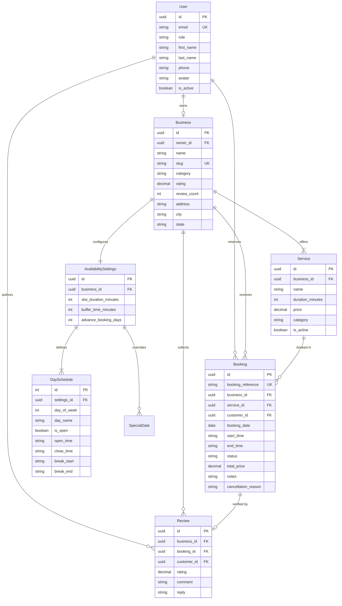

# Multi-Tenant Service Booking Platform (End-to-End MVP)

[](https://www.djangoproject.com/)
[](https://www.django-rest-framework.org/)
[](https://react.dev/)
[](https://www.typescriptlang.org/)
[](https://flutter.dev/)
[](https://www.postgresql.org/)
[](https://www.docker.com/)

An enterprise-grade, end-to-end multi-tenant service booking platform developed across three fully integrated application tiers:
1. **Business Owner Web Dashboard (`frontend/`)**: React 19 + TypeScript + Vite + Tailwind CSS v4, crafted with the minimalist card design inspired by Donezo, Nexus, and Mondays.
2. **Central REST API (`backend/`)**: Django 5.1 + Django REST Framework + PostgreSQL/SQLite, equipped with stateless SimpleJWT authentication, role-based access control (`admin`, `business_owner`, `customer`), dynamic availability engine, and notification hooks.
3. **Customer Mobile Application (`mobile/`)**: Flutter + Dart cross-platform mobile app targeting Android (and Web/iOS) for customer self-service discovery, dynamic time slot booking, and appointment lifecycle tracking.

---

## 📑 Table of Contents

- [System Architecture](#-system-architecture)
- [Key Features Across Tiers](#-key-features-across-tiers)
- [Repository Structure](#-repository-structure)
- [Git Branching Strategy](#-git-branching-strategy)
- [Seeded Demo Accounts & Credentials](#-seeded-demo-accounts--credentials)
- [Quickstart: Docker Compose](#-quickstart-docker-compose)
- [Local Development Setup](#-local-development-setup)
  - [1. Backend Setup (Django + PostgreSQL/SQLite)](#1-backend-setup-django--postgresqlsqlite)
  - [2. Frontend Setup (React 19 + TypeScript)](#2-frontend-setup-react-19--typescript)
  - [3. Mobile Setup (Flutter Android App)](#3-mobile-setup-flutter-android-app)
- [Physical Android Device Running & Debugging](#-physical-android-device-running--debugging)
- [REST API Endpoints Reference](#-rest-api-endpoints-reference)
- [Database Schema (ERD)](#-database-schema-erd)
- [Core Business Logic & Algorithms](#-core-business-logic--algorithms)
- [Testing & Quality Assurance](#-testing--quality-assurance)
- [Troubleshooting & FAQ](#-troubleshooting--faq)
- [Documentation & External Links](#-documentation--external-links)

---

## 🏛️ System Architecture

The platform follows a clean, decoupled client-server architecture where both client applications (React Dashboard & Flutter App) consume the identical centralized REST API.

```
┌───────────────────────────────────────┐       ┌───────────────────────────────────────┐
│     Business Owner Web Dashboard      │       │      Customer Mobile Application      │
│      React 19 • TypeScript • Vite     │       │            Flutter • Dart             │
│   (Services, Availability, Bookings)  │       │     (Discovery, Slots, Reservations)  │
└──────────────────┬────────────────────┘       └──────────────────┬────────────────────┘
                   │                                               │
                   │ HTTPS / JSON                                  │ HTTPS / JSON
                   │ Bearer JWT (Owner Role)                       │ Bearer JWT (Customer Role)
                   ▼                                               ▼
┌───────────────────────────────────────────────────────────────────────────────────────┐
│                           Django 5.1 REST API Backend                                 │
│                                                                                       │
│   ┌────────────────────┐   ┌────────────────────┐   ┌─────────────────────────────┐   │
│   │ SimpleJWT & RBAC   │   │ Availability Engine│   │ Booking & Conflict Manager  │   │
│   │ (Admin/Owner/Cust) │   │ (Slots Calculation)│   │ (Refs, States, Transitions) │   │
│   └────────────────────┘   └────────────────────┘   └─────────────────────────────┘   │
│                                                                                       │
│   ┌────────────────────┐   ┌────────────────────┐   ┌─────────────────────────────┐   │
│   │ Services Catalog   │   │ Review & Feedback  │   │ Notification Hook Signals   │   │
│   │ (Tiered Treatments)│   │ (Verified Ratings) │   │ (Email / Push Notifications)│   │
│   └────────────────────┘   └────────────────────┘   └─────────────────────────────┘   │
└───────────────────┬──────────────────────────────────────────────┬────────────────────┘
                    │                                              │
                    ▼                                              ▼
┌───────────────────────────────────────┐       ┌───────────────────────────────────────┐
│     PostgreSQL 16 / SQLite Engine     │       │    Notification Signal Receivers      │
│     (Relational Persistence Layer)    │       │     (Email / SMS / Push Hooks)        │
└───────────────────────────────────────┘       └───────────────────────────────────────┘
```

---

## ✨ Key Features Across Tiers

### 1. Centralized Backend API (`backend/`)
- **Authentication & Security**: Email-first custom `User` model, stateless JWT token pairs (`access` + `refresh`), password hashing, CORS protection.
- **Role-Based Access Control (RBAC)**: Custom permission classes (`IsAdminUser`, `IsBusinessOwner`, `IsCustomer`) ensuring complete multi-tenant tenant isolation.
- **Availability Engine**: Slot calculator computing real-time bookable slots from weekly business hours, buffer times, lunch breaks, and existing booking collisions.
- **Event-Driven Signals**: Decoupled Django signals (`booking_created`, `booking_status_changed`) dispatching email and push notification hooks.
- **Dual Database Support**: Automatic PostgreSQL 16 engine for Docker/production with transparent fallback to SQLite for rapid zero-config local testing.
- **Automated Verification**: End-to-end test suite (`test_api_endpoints.py`) covering all authentication, owner, and customer flows with 100% pass rate.

### 2. Business Owner Web Dashboard (`frontend/`)
- **Visual Aesthetic**: Inspired by Donezo, Nexus, and Mondays with a `#f4f5f7` canvas, deep forest green accents (`#144e3e`), white `rounded-3xl` cards, and capsule pill metrics.
- **7 Core Application Views**:
  - `Dashboard`: Real-time KPI summary (revenue, active bookings, weekly trend chart, today's schedule preview).
  - `Bookings Management`: Filterable list by status (`All`, `Pending`, `Confirmed`, `Completed`, `Cancelled`), 1-click status approve/reject.
  - `Services Catalog`: CRUD modal manager for service names, descriptions, categories, durations, and pricing.
  - `Availability Editor`: Weekly schedule configurator (open/close hours, breaks) paired with a live Flutter customer slot simulator.
  - `Analytics & Reports`: Revenue trends, top-grossing treatments, and confirmation rate metrics.
  - `Business Settings`: Lounge branding, contact information, Soho address, and operating parameters.
  - `Authentication`: Clean sign-in and registration pages with pre-filled demo account buttons.

### 3. Customer Mobile Application (`mobile/`)
- **Cross-Platform**: Built with Flutter 3.x and Dart, targeting Android devices, emulators, and Web/iOS.
- **Design Tokens**: Aligned with the web dashboard palette (`AppColors.primary` forest green, lime mint badges, clean white cards).
- **Customer User Journey**:
  - *Customer Auth*: Persistent session management with `SharedPreferences` and 1-tap demo login.
  - *Explore & Search*: Business directory with category chips (*Barbershop*, *Spa & Facial*, *Haircut*, *Wellness*) and featured hero banner.
  - *Services & Reviews*: Treatment cards displaying pricing, duration, full descriptions, customer ratings, and owner responses.
  - *Time Slot Booking*: 14-day interactive date selector carousel with real-time open slot chips and customer note input.
  - *Confirmation*: Instant unique reference code badge (e.g. `BK-8901`) with notification hook feedback.
  - *Booking History*: Tabbed views for *Upcoming* vs *Past / Cancelled* appointments with in-app slot cancellation.
  - *Host Switcher*: In-app modal under **Profile > Backend API Host** allowing instant toggling between Android emulator (`10.0.2.2:8000`), local machine (`127.0.0.1:8000`), or Wi-Fi LAN IP (`192.168.101.240:8000`).

---

## 📁 Repository Structure

```
service-booking-platform/
├── frontend/                               # React 19 Business Owner Dashboard
│   ├── src/
│   │   ├── components/                     # Layout, Sidebar, Navbar, StatCards, CapsuleChart
│   │   ├── pages/                          # Dashboard, Bookings, Services, Availability, Analytics, Settings, Auth
│   │   ├── services/                       # API service layer with Django integration & fallback
│   │   ├── types/                          # TypeScript definitions for User, Business, Service, Booking
│   │   ├── App.tsx                         # React Router v7 routes
│   │   ├── main.tsx                        # React application entrypoint
│   │   └── index.css                       # Tailwind CSS v4 styling & custom pattern-stripes
│   ├── package.json                        # Dependencies (React 19, Lucide, Tailwind v4, Vite 8)
│   ├── vite.config.ts                      # Vite configuration with @tailwindcss/vite plugin
│   └── tsconfig.app.json                   # TypeScript compiler configuration
├── backend/                                # Django 5.1 REST Framework API
│   ├── apps/
│   │   ├── authentication/                 # Custom User model (UUID, email-first, roles), JWT views, permissions
│   │   ├── businesses/                     # Business model, owner profile endpoint, public directory
│   │   ├── services/                       # Service catalog model, serializers, CRUD ViewSet
│   │   ├── availability/                   # Weekly schedules, special dates, dynamic slot generator
│   │   ├── bookings/                       # Booking model, reference generation, status action, conflict prevention
│   │   ├── reviews/                        # Verified customer reviews & owner replies
│   │   ├── notifications/                  # Signal handlers logging email/push hooks
│   │   └── analytics/                      # Summary metrics, revenue calculations, 7-day revenue trend
│   ├── core/                               # Settings (dual DB engine, CORS, SimpleJWT), URLs, WSGI, ASGI
│   ├── Dockerfile                          # Multi-stage container definition
│   ├── requirements.txt                    # Python dependencies
│   ├── test_api_endpoints.py               # Automated verification suite (Owner & Customer tests)
│   └── manage.py                           # Django CLI management script
├── mobile/                                 # Flutter Customer Android App
│   ├── android/
│   │   └── app/src/main/AndroidManifest.xml# Android permissions (INTERNET, ACCESS_NETWORK_STATE)
│   ├── lib/
│   │   ├── constants/                      # ApiConstants (host endpoints) & AppColors (Donezo palette)
│   │   ├── models/                         # UserModel, BusinessModel, ServiceModel, BookingModel, ReviewModel
│   │   ├── services/                       # ApiService (JWT client), AuthProvider, BookingProvider
│   │   ├── screens/                        # Auth, Home, BusinessDetail, SelectSlot, Confirmation, History, Profile
│   │   └── main.dart                       # App entrypoint, Provider registration & Material3 theme
│   ├── pubspec.yaml                        # Flutter dependencies (http, provider, intl, shared_preferences)
│   └── README.md                           # Mobile-specific documentation
├── docs/                                   # Architecture and specifications
│   ├── FRONTEND_DOCUMENTATION.md           # Frontend specification & API contract
│   └── BACKEND_DOCUMENTATION.md            # Backend architecture & schema reference
├── docker-compose.yml                      # PostgreSQL 16 + Django REST API service orchestration
├── .gitignore                              # Comprehensive exclusions for Node, Python, Flutter, and IDEs
└── README.md                               # Master project documentation
```

---

## 🌿 Git Branching Strategy

The repository follows an isolated milestone branching workflow where each feature was developed, verified, and merged cleanly into `main`:

```text
* 8bd1f94 (HEAD -> main) merge: integrate Flutter customer Android mobile app
|\  
| * 44f03d6 (feature/mobile-app) feat(mobile): implement Flutter customer Android app
|/  
* b9831e9 merge: integrate Django REST API backend service
|\  
| * b66227d (feature/backend-api) feat(backend): implement Django REST API with JWT, RBAC, seed data
|/  
* 857b110 merge: integrate frontend business owner dashboard
|\  
| * eddc893 docs: add comprehensive frontend specification and API contract
| * 99c66e9 style(frontend): refine UI with Donezo-inspired clean color palette
| * 6d65b33 (feature/frontend-dashboard) feat(frontend): build React business owner dashboard
|/  
* 9fc5e50 initial repository structure
```

| Branch | Description | Current Status |
|---|---|---|
| **`feature/frontend-dashboard`** | React 19 web dashboard for business owners | ✅ Merged into `main` |
| **`feature/backend-api`** | Django 5.1 REST API, PostgreSQL models, seed data & tests | ✅ Merged into `main` |
| **`feature/mobile-app`** | Flutter Android customer application | ✅ Merged into `main` |
| **`main`** | Production-ready consolidated baseline | ✅ Active & Up to date |

To switch to any branch:
```bash
git checkout feature/mobile-app
# or
git checkout main
```

---

## 👥 Seeded Demo Accounts & Credentials

The database comes pre-seeded with realistic production-like demo data matching both the web dashboard and mobile app:

| Role | Email Address | Password | Target Platform | Description |
|---|---|---|---|---|
| **Business Owner** | `marcus@apexgrooming.com` | `ApexPass123!` | React Web Dashboard | Marcus Sterling, Owner of Apex Grooming Lounge |
| **Customer 1** | `totok.michael@example.com` | `CustomerPass123!` | Flutter Customer App | Premier Customer with existing active bookings |
| **Customer 2** | `alexandra.deff@example.com` | `CustomerPass123!` | Flutter Customer App | Regular Customer with past completed sessions |
| **Admin** | `admin@platform.com` | `AdminPass123!` | Django Admin (`/admin/`) | Platform Administrator with full superuser privileges |

---

## 🚀 Quickstart: Docker Compose

The fastest way to spin up the entire backend infrastructure (PostgreSQL 16 database + Django REST API with auto-migrations and data seeding):

```bash
# Clone the repository
git clone https://github.com/your-username/service-booking-platform.git
cd service-booking-platform

# Boot PostgreSQL 16 + Django API
docker compose up --build
```

- **Backend REST API**: Accessible at `http://localhost:8000/api/`
- **Health Check**: `http://localhost:8000/api/health/`
- **Django Admin Portal**: `http://localhost:8000/admin/`

---

## 💻 Local Development Setup

If running without Docker, follow the steps below for each tier.

### 1. Backend Setup (Django + PostgreSQL/SQLite)

#### Prerequisites
- Python 3.11+ (Python 3.13 recommended)
- Virtual environment tool (`venv`)

#### Step-by-Step Commands
```powershell
# 1. Navigate to backend directory
cd c:\service-booking-platform\backend

# 2. Create Python virtual environment
python -m venv venv

# 3. Activate virtual environment
# On Windows:
venv\Scripts\activate
# On macOS/Linux:
# source venv/bin/activate

# 4. Install dependencies
pip install -r requirements.txt

# 5. Run migrations
python manage.py makemigrations authentication businesses services availability bookings reviews notifications analytics
python manage.py migrate

# 6. Seed demo business, services, schedules, and bookings
python manage.py seed_data

# 7. Run automated test suite to verify 100% functionality
python test_api_endpoints.py

# 8. Start local API server
python manage.py runserver 0.0.0.0:8000
```
The Django server starts at `http://127.0.0.1:8000/`.

---

### 2. Frontend Setup (React 19 + TypeScript)

#### Prerequisites
- Node.js 18+ (Node 20 or 22 LTS recommended)
- npm or yarn

#### Step-by-Step Commands
```powershell
# 1. Open a new terminal and navigate to frontend
cd c:\service-booking-platform\frontend

# 2. Install dependencies
npm install

# 3. Start Vite development server
npm run dev
```
The dashboard opens instantly at `http://localhost:5173/`.

To verify TypeScript and production assets:
```powershell
npm run build
# Compiles in ~600ms with zero errors
```

---

### 3. Mobile Setup (Flutter Android App)

#### Prerequisites
- [Flutter SDK](https://docs.flutter.dev/get-started/install/windows/mobile) (3.x+)
- Android Studio with Android SDK Platform-Tools
- An active Android emulator OR physical Android smartphone connected via USB

#### Installing Flutter on Windows (if not yet installed)
Choose **one** of the following options:

- **Option A (winget - 1 command)**:
  ```powershell
  winget install --id Flutter.Flutter --accept-source-agreements --accept-package-agreements
  ```
  *Restart your PowerShell terminal after installation.*

- **Option B (Git Clone - Recommended for Developers)**:
  ```powershell
  mkdir C:\src -ErrorAction SilentlyContinue
  cd C:\src
  git clone https://github.com/flutter/flutter.git -b stable
  [Environment]::SetEnvironmentVariable("Path", [Environment]::GetEnvironmentVariable("Path", "User") + ";C:\src\flutter\bin", "User")
  ```
  *Restart your PowerShell terminal.*

- **Option C (Manual Zip)**:
  Download the official bundle from [flutter.dev](https://docs.flutter.dev/get-started/install/windows/mobile), extract into `C:\src\flutter`, and add `C:\src\flutter\bin` to your User PATH.

#### Running the App
```powershell
cd c:\service-booking-platform\mobile

# Fetch packages
flutter pub get

# Check detected devices
flutter devices

# Launch on connected Android device or emulator
flutter run

# Or launch on Web Chrome for instant desktop testing
flutter run -d chrome
```

---

## 📱 Physical Android Device Running & Debugging

To run and debug the app directly on your physical Android phone:

### Step 1: Enable USB Debugging on Your Android Phone
1. Open **Settings** on your phone.
2. Go to **About Phone** (or *System > About Phone*).
3. Find **Build Number** and tap it **7 times** until you see *"You are now a developer!"*.
4. Return to **Settings > System > Developer Options**.
5. Enable **USB Debugging** (and enable "Install via USB" if prompted).
6. Connect your phone to your PC with a USB cable.
7. When the popup **"Allow USB debugging?"** appears on your phone, check **"Always allow from this computer"** and tap **Allow**.

### Step 2: Route Requests from Phone to PC Backend
Because your phone is an independent physical device, it cannot access `127.0.0.1:8000` directly without port forwarding:

#### Method A: ADB Reverse Port Forwarding (Recommended — Zero Network Setup)
With your phone connected via USB, run this in PowerShell:
```powershell
adb reverse tcp:8000 tcp:8000
```
> **How this works**: Any network call made from your phone to `http://127.0.0.1:8000` is forwarded over the USB cable directly to the Django server running on your PC!

#### Method B: Over Local Wi-Fi (LAN IP)
If both your phone and PC are connected to the same Wi-Fi network:
1. Your PC's Wi-Fi IP address is: `192.168.101.240` (verify anytime via `ipconfig`).
2. Start Django listening on all interfaces:
   ```powershell
   python manage.py runserver 0.0.0.0:8000
   ```
3. In the mobile app, go to **Profile > Backend API Host** and set the URL to:
   `http://192.168.101.240:8000/api`

### Step 3: Run Flutter with Live Hot Reload
```powershell
cd c:\service-booking-platform\mobile
flutter run
```
- Press <kbd>r</kbd> for **Hot Reload** (instant sub-second UI updates).
- Press <kbd>R</kbd> for **Hot Restart** (re-initializes state).
- Press <kbd>q</kbd> to stop debugging.

---

## 📋 REST API Endpoints Reference

All endpoints are prefixed with `/api/`.

### 1. Health & Status
| Method | Endpoint | Description | Auth Required |
|---|---|---|---|
| `GET` | `/api/health/` | Health check probe | Public |

### 2. Authentication (`/api/auth/`)
| Method | Endpoint | Description | Payload |
|---|---|---|---|
| `POST` | `/api/auth/register/` | Register customer or owner | `{email, password, role, first_name, last_name, phone}` |
| `POST` | `/api/auth/login/` | Obtain JWT token pair | `{email, password}` -> `{access, refresh, user}` |
| `POST` | `/api/auth/token/refresh/` | Refresh expired access token | `{refresh}` -> `{access}` |

### 3. Business Management (`/api/business/`)
| Method | Endpoint | Description | Permission |
|---|---|---|---|
| `GET` | `/api/business/me/` | Fetch current owner's business | `IsBusinessOwner` |
| `PUT/PATCH`| `/api/business/profile/` | Update business profile details | `IsBusinessOwner` |
| `GET` | `/api/business/directory/` | Public lounge catalog (Flutter browse) | Public |
| `GET` | `/api/business/directory/{id}/` | Single lounge detail | Public |

### 4. Services Catalog (`/api/services/`)
| Method | Endpoint | Description | Permission |
|---|---|---|---|
| `GET` | `/api/services/` | List services (filter by `?business_id=`) | Public |
| `POST` | `/api/services/` | Create a new service | `IsBusinessOwner` |
| `PUT/PATCH`| `/api/services/{id}/` | Update service pricing/duration | `IsBusinessOwner` |
| `DELETE` | `/api/services/{id}/` | Deactivate/delete service | `IsBusinessOwner` |

### 5. Availability & Time Slots (`/api/availability/`)
| Method | Endpoint | Description | Permission |
|---|---|---|---|
| `GET` | `/api/availability/` | Get weekly schedule and buffer rules | `IsBusinessOwner` |
| `PUT` | `/api/availability/` | Update weekly schedule and break times | `IsBusinessOwner` |
| `GET` | `/api/availability/slots/` | Public dynamic bookable slots (`?date=YYYY-MM-DD`) | Public |

### 6. Bookings & Appointments (`/api/bookings/`)
| Method | Endpoint | Description | Permission |
|---|---|---|---|
| `GET` | `/api/bookings/` | List bookings (Owner: business; Customer: user) | Authenticated |
| `POST` | `/api/bookings/` | Reserve an appointment slot | Public / Authenticated |
| `GET` | `/api/bookings/{id}/` | View booking details | Authenticated |
| `PATCH` | `/api/bookings/{id}/status/` | Update status (`confirmed`, `cancelled`, etc.)| `IsBusinessOwner` |

### 7. Reviews & Ratings (`/api/reviews/`)
| Method | Endpoint | Description | Permission |
|---|---|---|---|
| `GET` | `/api/reviews/` | List verified reviews (filter by `?business_id=`) | Public |
| `POST` | `/api/reviews/{id}/reply/` | Business owner reply to review | `IsBusinessOwner` |

### 8. Analytics & Metrics (`/api/analytics/`)
| Method | Endpoint | Description | Permission |
|---|---|---|---|
| `GET` | `/api/analytics/summary/` | Gross revenue, booking rates, top services | `IsBusinessOwner` |

---

## 🗄️ Database Schema (ERD)



---

## ⚙️ Core Business Logic & Algorithms

### 1. Dynamic Time Slot Generation Algorithm
The slot engine in `apps.availability.views.AvailableSlotsPublicView` guarantees collision-free booking options:
1. **Date Validation**: Converts requested string `YYYY-MM-DD` to a date object.
2. **Special Date Overrides**: Queries `SpecialDate` model. If marked closed (e.g., national holiday), instantly returns `is_open: false, slots: []`.
3. **Weekly Schedule Mapping**: Computes zero-indexed day of week (`(python_weekday + 1) % 7`). If marked closed in `DaySchedule`, returns `is_open: false`.
4. **Boundary Definition**: Extracts `open_time` (e.g. `09:00`) and `close_time` (e.g. `18:30`).
5. **Minute Stepper**: Converts hours/minutes to total minutes from midnight and steps forward by `slot_duration_minutes` (e.g. 30 min).
6. **Break Exclusion**: Any slot overlapping `break_start` to `break_end` (e.g., lunch 13:00 - 14:00) is filtered out.
7. **Collision Filtering**: Checks against existing active bookings (`pending` or `confirmed`) for the same service provider on that day.
8. **Output**: Formatted array of available start times: `["09:00", "09:30", "10:00", "10:30", ...]`.

### 2. Event-Driven Notification Lifecycle
Django signals in `apps.notifications` provide decoupled event handling:
- **`booking_created` Signal**: Fires when a customer creates a reservation. The handler logs structured payloads simulating an SMTP email delivery and sends a push notification hook to the lounge owner.
- **`booking_status_changed` Signal**: Fires when an owner updates status to `confirmed`, `completed`, or `cancelled`. The customer receives an automated status notification with their reference code.

---

## 🧪 Testing & Quality Assurance

### Automated Backend Test Suite
The backend includes a comprehensive automated test script (`backend/test_api_endpoints.py`) testing every major flow using DRF's `APIClient`:
- Health check probe (`/api/health/`)
- Business owner JWT sign-in and token claims
- Business profile fetch (`/api/business/me/`)
- Services catalog query
- Availability settings & dynamic slot generation
- Booking status update action (`PATCH /status/`)
- Analytics calculations (revenue aggregate & confirmation rates)
- Customer login (`totok.michael@example.com`)
- Customer lounge browsing (`/api/business/directory/`)
- Customer booking creation with reference verification (`BK-xxxx`)
- Customer appointment history retrieval

Run the test suite anytime:
```powershell
cd backend
venv\Scripts\activate
python test_api_endpoints.py
```
**Output**: `ALL API TESTS (OWNER + CUSTOMER) PASSED 100%!`

### Frontend Build Verification
The frontend code adheres to strict TypeScript checks with zero compilation errors:
```powershell
cd frontend
npm run build
```
**Output**: `✓ built in ~600ms`

---

## ❓ Troubleshooting & FAQ

#### Q1: `flutter : The term 'flutter' is not recognized`
**Cause**: The Flutter SDK is not installed or its `bin` folder is missing from your system `PATH`.  
**Solution**: Run `winget install --id Flutter.Flutter --accept-source-agreements --accept-package-agreements`, or clone Flutter into `C:\src\flutter` and add `C:\src\flutter\bin` to your User Environment Variables. Then restart your terminal.

#### Q2: My Android phone cannot connect to the backend server
**Cause**: Mobile devices treat `127.0.0.1` as their own internal loopback, not your PC's localhost.  
**Solution**: Plug the phone in via USB and run `adb reverse tcp:8000 tcp:8000`. Alternatively, connect both devices to the same Wi-Fi and set the host in the mobile app's profile screen to your PC's IP (`http://192.168.101.240:8000/api`).

#### Q3: Database connection errors when starting without Docker
**Cause**: PostgreSQL environment variables are not set for local execution.  
**Solution**: The backend automatically falls back to `db.sqlite3` when `POSTGRES_DB` is not defined in the environment. Run `python manage.py migrate && python manage.py seed_data` to initialize the database immediately.

#### Q4: CORS errors when calling API from frontend
**Cause**: Request origin is not allowed in Django settings.  
**Solution**: `backend/core/settings.py` includes `http://localhost:5173`, `http://127.0.0.1:5173`, and `http://localhost:3000` in `CORS_ALLOWED_ORIGINS` by default.

---

## 📚 Documentation & External Links

- **Frontend Technical Specification**: [docs/FRONTEND_DOCUMENTATION.md](file:///c:/service-booking-platform/docs/FRONTEND_DOCUMENTATION.md)
- **Backend Architecture Specification**: [docs/BACKEND_DOCUMENTATION.md](file:///c:/service-booking-platform/docs/BACKEND_DOCUMENTATION.md)
- **Interactive Google Docs Sync**: [Google Docs Link](https://docs.google.com/document/d/1SBGDQvN8jIzcR52m7mbVkOaMitnZSBpStVwSeLwH4-w/edit)
- **Backend Dedicated README**: [backend/README.md](file:///c:/service-booking-platform/backend/README.md)
- **Mobile Dedicated README**: [mobile/README.md](file:///c:/service-booking-platform/mobile/README.md)
